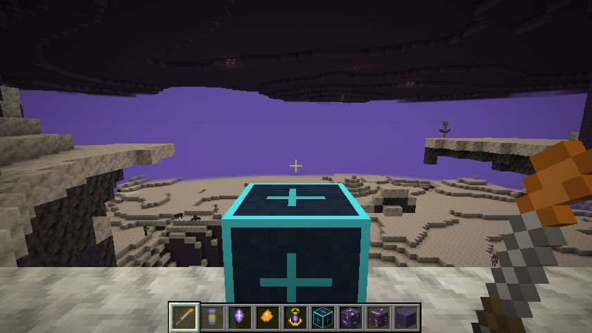
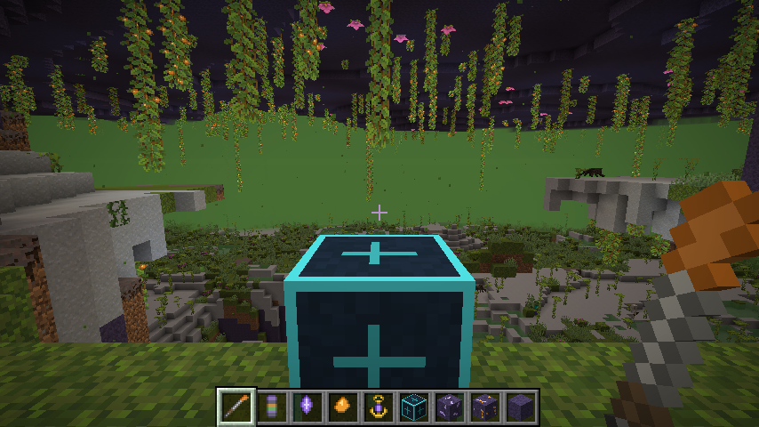

# Strata – Tiefenzeit

Ein Modset für Minecraft-Modpacks. Das Konzept steht in [KONZEPT.md](KONZEPT.md).

| Mod | Inhalt | Stand |
|---|---|---|
| **Strata Core** | Epochen und Kodex-Knoten per Datapack, Kodex-Fortschritt, `/strata`-Befehle, öffentliche API | fertig für den MVP |
| **Strata Epochs** | Kernbohrer, Bohrkerne, Epochentor, Verfestigung, Dimensionen Kristallzeit und Sporenzeit | erster spielbarer Stand |
| Strata Bridge | Integrationen (EMI/JEI, Jade, KubeJS, FTB Quests …) | geplant |

## Unterstützte Versionen

| Minecraft | NeoForge | Java |
|---|---|---|
| 1.21.1 | 21.1.265 | 21 |
| 1.21.11 | 21.11.48 | 21 |
| 26.1.x | 26.1.2.124 | 25 |
| 26.2 | 26.2.0.93 | 25 |
| 26.3 | 26.3.0.99 | 25 |

Für jede Version gilt: Beide Mods bauen, der Server startet, und ein Selbsttest generiert beide Epochen-Dimensionen.

Nicht jede 1.21-Zwischenversion (1.21.2 bis 1.21.10) wird unterstützt. Modpacks sammeln sich auf wenigen Versionen: 1.21.1 ist die große Modpack-Basis, 1.21.11 die letzte 1.21-Version. Eine Zwischenversion lässt sich bei konkreter Nachfrage ergänzen (siehe unten).

## So spielt sich Strata Epochs

| Kristallzeit | Sporenzeit |
|---|---|
|  |  |

*Ankunft in den Epochen (Minecraft 1.21.1). Vorne das Epochentor für den Rückweg, unten alle neuen Items.*

1. **Kernbohrer** bauen (Eisen, Kupfer, Stock) und auf den Boden rechtsklicken. Du bekommst einen **Bohrkern**. Er zeigt, welche Epoche unter diesem Ort liegt. Jede Region von 8 × 8 Chunks hat ihre eigene Epoche.
2. **Epochentor** bauen (Obsidian, Amethyst, Kompass) und mit dem Bohrkern rechtsklicken. Der Kern wird verbraucht, und du landest in der Epoche. Neben dir steht ein Tor für den Rückweg.
3. In der **Kristallzeit** findest du Kristallquarz, in der **Sporenzeit** Bernstein. Beide Dimensionen sind Höhlenwelten aus **Zeitgestein**.
4. **Verfestigung:** Nach 75 % der erlaubten Zeit (Kristallzeit 10 min, Sporenzeit 7 min) kommt eine Warnung. Danach wirst du langsamer, und um dich herum versteinern Blöcke.
5. Ein **Zeitanker** im Inventar (Kristallquarz, Bernstein, Gold) verdoppelt die erlaubte Zeit.
6. Rechtsklick auf das Tor bringt dich zurück. Tore in Epochen lassen sich nicht abbauen, damit der Rückweg nie verloren geht.

Kodex-Knoten werden automatisch freigeschaltet: `strata_epochs:first_core` mit dem ersten Bohrkern, `visited_crystal_age` bzw. `visited_spore_age` beim ersten Besuch einer Epoche.

## Aufbau

```
versions/<v>/gradle.properties   MC-, NeoForge- und Java-Version, Quellordner je Mod
common/                          Reine Spiellogik ohne Minecraft + JUnit-Tests
core/src/shared/                 Strata Core, in allen Versionen gleich (inkl. api/StrataAPI)
core/src/mc_*/, dpreg_*/         Versionsanbindung von Core (Klassen Mc, McDatapack)
epochs/src/shared/               Strata Epochs, in allen Versionen gleich; Assets, Tags, Lang
epochs/src/reg_*/, break_*/      Versionsanbindung von Epochs (Reg, BreakHook)
epochs/worldgen/                 Epochen-Spezifikation und Rezepte (Quelle für das Worldgen)
epochs/worldgen.gradle           Erzeugt Worldgen, Loot-Tabellen und Rezepte pro Version
example-datapacks/strata-demo/   Demo-Datapack (2 Epochen ohne Dimension, 3 Kodex-Knoten)
scripts/smoke-test.sh            Startet pro Version einen Server und prüft das Log
scripts/client-screenshot.sh     Startet den Client auf einem virtuellen Bildschirm und macht einen Screenshot
tools/make_textures.py           Erzeugt die Platzhaltertexturen
```

**Warum das Worldgen erzeugt wird:** Mojang ändert das Format von Dimensionen, Biomen, Erz-Features, Loot-Tabellen und Rezepten fast in jeder Version. In 1.21.11 kamen z. B. „attributes“ dazu, in 26.3 wurde `configured_feature` zu `feature`. Der Task `generateEpochData` nimmt deshalb die Vanilla-Dateien genau der gebauten Version als Vorlage (Höhlen-Dimension, Höhlen-Noise, Tropfstein- und Üppige-Höhlen-Biom, Vanilla-Loot) und ändert nur wenige Felder.

## Bauen und testen

Gradle braucht zum Starten Java 17 oder neuer. Fehlende JDKs (21 für 1.21.x, 25 für 26.x) lädt Gradle automatisch herunter.

```bash
./gradlew :common:test                 # Spiellogik testen
./gradlew build                        # alle Mods für alle Versionen bauen
./gradlew :epochs-26.3:build           # eine Mod für eine Version
./gradlew :epochs-1.21.1:runClient     # Spiel mit Core + Epochs starten
scripts/smoke-test.sh                  # Server + Selbsttest in allen Versionen
scripts/smoke-test.sh 1.21.1 26.3      # nur bestimmte Versionen
```

Die fertigen Jars liegen unter `core/versions/<v>/build/libs/` und `epochs/versions/<v>/build/libs/`.

## Eigene Epoche hinzufügen (Pack-Autoren)

Eine Epoche ohne eigene Dimension braucht nur ein Datapack, siehe `example-datapacks/strata-demo`. Bohrkerne zeigen sie dann an, das Tor meldet „noch nicht erreichbar“.

Eine Epoche mit Dimension kommt in `epochs/worldgen/epochs.json` (Vorlage-Biom, Farben, Erze) plus einen Eintrag unter `epochs/src/shared/resources/data/strata_epochs/strata_core/epoch/`. Andere Mods können auch eigene Dimensionen per Datapack mitbringen und im Feld `dimension` darauf verweisen.

## Neue Minecraft-Version hinzufügen

1. `versions/<v>/gradle.properties` anlegen (Vorlage: eine bestehende Version).
2. `./gradlew :core-<v>:compileJava :epochs-<v>:compileJava` ausführen.
3. Meldet der Compiler Fehler, eine neue Quellgruppe unter `core/src/` bzw. `epochs/src/` mit angepasster Anbindungsklasse anlegen und in `gradle.properties` eintragen.
4. `scripts/smoke-test.sh <v>` ausführen und die Version in die CI-Matrix (`.github/workflows/build.yml`) aufnehmen.

## Datapack-Format (Strata Core)

```
data/<namespace>/strata_core/epoch/<name>.json
{ "weight": 3, "solidify_seconds": 600, "dimension": "strata_epochs:crystal_age" }

data/<namespace>/strata_core/codex_node/<name>.json
{ "requires": ["<namespace>:first_core"] }
```

- `weight`: Häufigkeit der Epoche unter der Oberwelt (0 = nie).
- `solidify_seconds`: Zeit bis zur Verfestigung (0 = aus, Standard 600).
- `dimension`: optional.

## Befehle

| Befehl | Wer | Zweck |
|---|---|---|
| `/strata epoch` | alle | Welche Epoche liegt unter mir? |
| `/strata codex list` | alle | Eigener Kodex-Fortschritt und nächste Schritte |
| `/strata codex unlock <knoten>` | OP | Knoten freischalten |
| `/strata codex validate` | OP | Kodex-Datapack auf Tippfehler und Zyklen prüfen |

## Noch offen

- Automatisch getestet ist der Server in allen Versionen. Der Client wurde in 1.21.1 gestartet (Modelle, Texturen und beide Dimensionen laden, siehe Screenshots). Für 26.x fehlt der Client-Test, weil der virtuelle Bildschirm der Testumgebung kein passendes OpenGL-Fenster bietet. Richtig gespielt (Bohren, Tor, Verfestigung von Hand) wurde noch nicht.
- Die Texturen sind Platzhalter.
- Welten mit Epochen zeigen beim ersten Laden die Vanilla-Warnung „experimentelle Einstellungen“. Das ist bei Datapack-Dimensionen normal; einmal bestätigen reicht.
- Kernanalyse-Tisch, Fossilien, Transplantator und weitere Biome pro Epoche (siehe Konzept, Phase 3).
- Strata Bridge.
