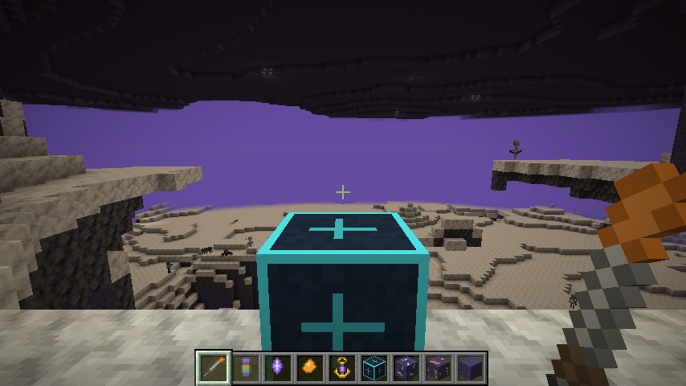
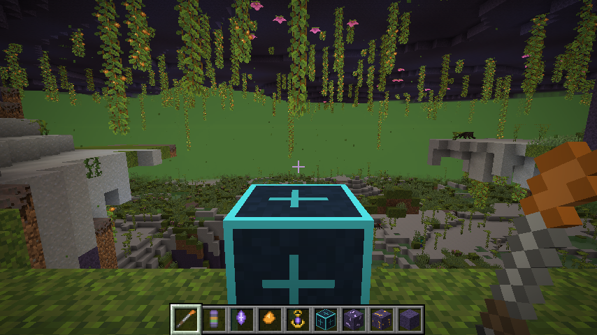
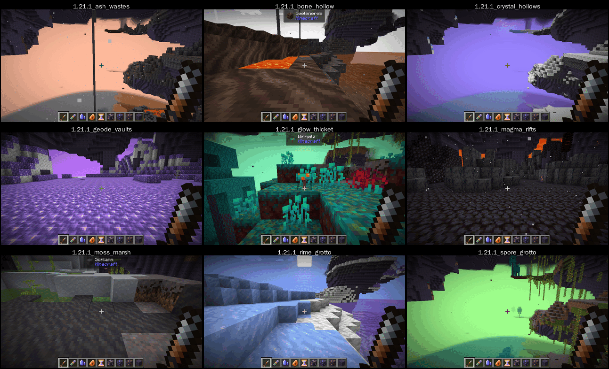
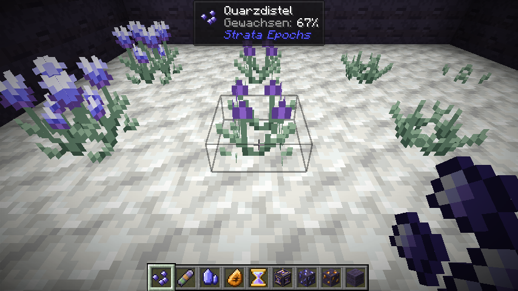
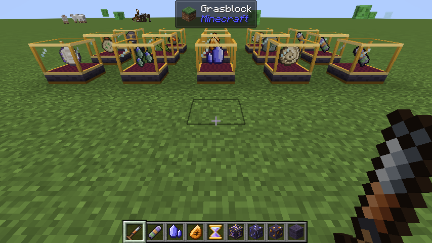
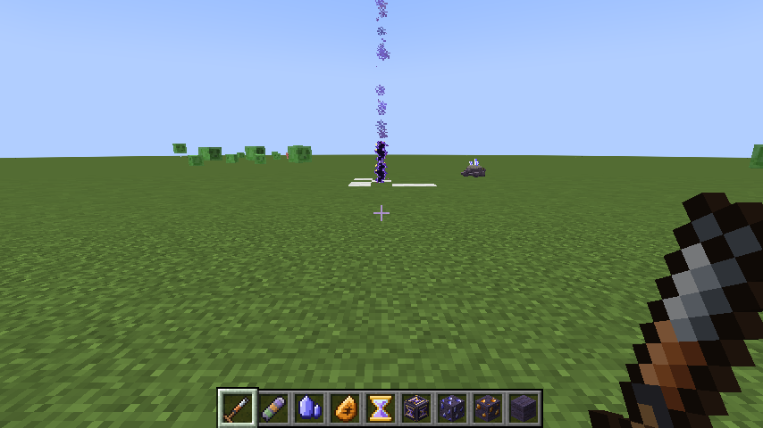
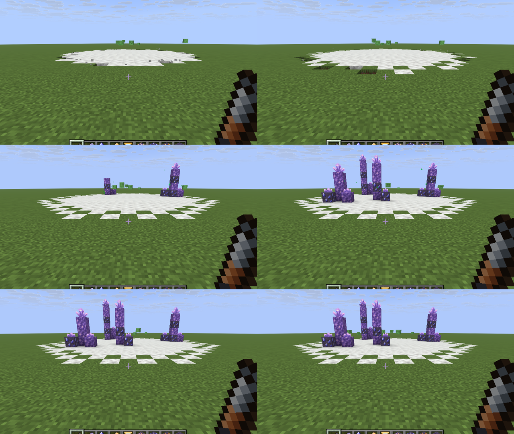
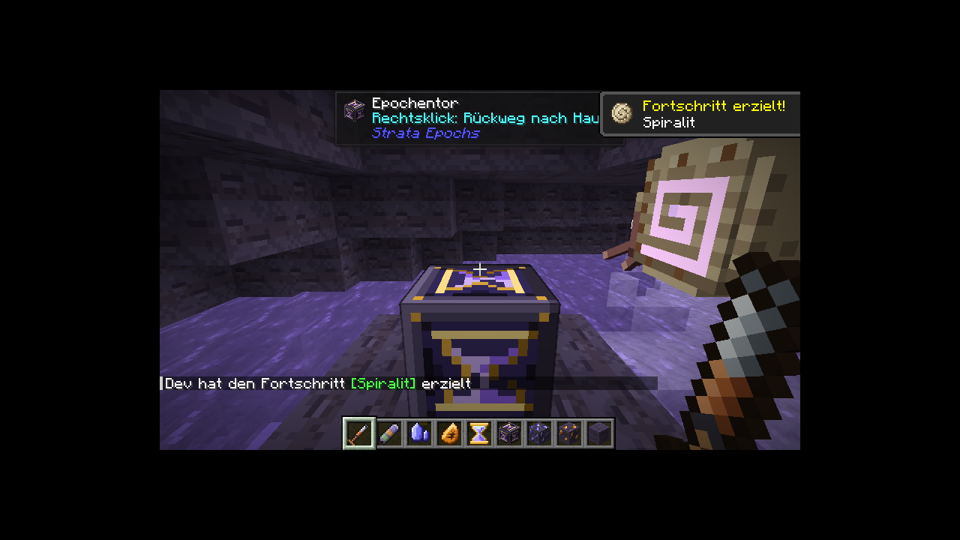
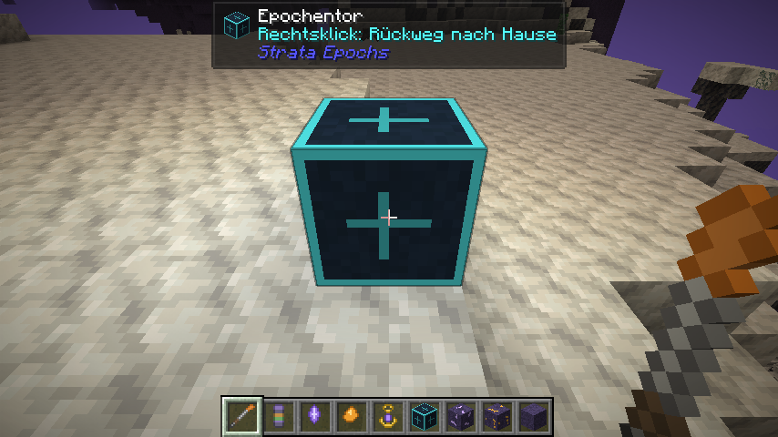

# Strata – Tiefenzeit

Ein Modset für Minecraft-Modpacks. Das Konzept steht in [KONZEPT.md](KONZEPT.md), der Plan für eigene Mobs in [docs/MOBS.md](docs/MOBS.md).

Eine Hauptmod und zwei Addons. Alle Texte gibt es auf Deutsch und Englisch.

| Mod | Rolle | Inhalt |
|---|---|---|
| **Strata Core** | Hauptmod (Pflicht) | Epochen, Kodex-Knoten und Mob-Werte per Datapack, Kodex-Fortschritt, `/strata`-Befehle, öffentliche API |
| **Strata Epochs** | Addon (braucht Core) | Kernbohrer, Epochentor, Verfestigung, Kristallzeit und Sporenzeit, 3 Mobs, Ausrüstung |
| **Strata Bridge** | Addon (braucht Core und Epochs) | JEI- und EMI-Infoseiten, Jade-Hinweise, Curios-Slot für den Zeitanker, KubeJS-Plugin, Advancements für Quest-Mods |

## Unterstützte Versionen

| Minecraft | NeoForge | Java |
|---|---|---|
| 1.21.1 | 21.1.265 | 21 |
| 1.21.11 | 21.11.48 | 21 |
| 26.1.x | 26.1.2.124 | 25 |
| 26.2 | 26.2.0.93 | 25 |
| 26.3 | 26.3.0.99 | 25 |

Für jede Version gilt: Alle drei Mods bauen, und der Server startet mit dem ganzen Set plus JEI und Jade. Ein Selbsttest generiert beide Epochen-Dimensionen, findet alle Advancements und prüft die Kette „Kodex-Knoten freischalten → Event → Advancement“.

| Fremd-Mod | 1.21.1 | 1.21.11 | 26.1 | 26.2 | 26.3 |
|---|---|---|---|---|---|
| JEI | 19.70 | 27.54 | 29.53 | 30.48 | 31.17 |
| Jade | 15.10 | 21.1 | 26.1 | 26.2 | 26.3 |

Beide sind optional. Strata läuft auch ohne sie.

Nicht jede 1.21-Zwischenversion (1.21.2 bis 1.21.10) wird unterstützt. Modpacks sammeln sich auf wenigen Versionen: 1.21.1 ist die große Modpack-Basis, 1.21.11 die letzte 1.21-Version. Eine Zwischenversion lässt sich bei konkreter Nachfrage ergänzen (siehe unten).

## So spielt sich Strata Epochs

| Kristallzeit | Sporenzeit |
|---|---|
|  |  |

*Ankunft in den Epochen (Minecraft 1.21.1). Vorne das Epochentor für den Rückweg, unten alle neuen Items.*

1. **Kernbohrer** bauen (Eisen, Kupfer, Stock) und auf den Boden rechtsklicken. Du bekommst einen **Bohrkern**. Er zeigt, welche Epoche unter diesem Ort liegt. Jede Region von 8 × 8 Chunks hat ihre eigene Epoche. Epochen liegen verschieden tief:
   - Der Kernbohrer (Stufe 1) erreicht die Kristallzeit.
   - Der **Kristall-Kernbohrer** (Stufe 2: Kernbohrer und 4 Kristallquarz) erreicht auch die Sporenzeit.
   - Der **Tiefenkernbohrer** (Stufe 3: Kristall-Kernbohrer, Bernstein und eine Spitze aus dem Tag `strata_epochs:deep_drill_tips`, Standard Diamant) erreicht auch die **Aschezeit**.
2. **Epochentor** bauen (Obsidian, Amethyst, Kompass) und mit dem Bohrkern rechtsklicken. Der Kern wird verbraucht, und du landest in der Epoche. Neben dir steht ein Tor für den Rückweg.


3. Alle drei Epochen sind Höhlenwelten aus **Zeitgestein** mit je **drei Biomen**. Wo du ankommst, hängt von deinem Ort in der Oberwelt ab. Das Hauptbiom nimmt gut die Hälfte ein, die beiden anderen sind kleiner und lohnen sich mit mehr Epochen-Erz. Sie liegen höchstens 300 Blöcke vom Ankunftsort entfernt (Selbsttest), meist deutlich näher. Der Ankunftsplatz steht immer auf sicherem Boden, nie auf Magma. Bei der Ankunft **peilt das Tor die Biome**: Im Chat steht, in welchem Biom du bist und wo die anderen beiden liegen, relativ zu deiner Blickrichtung („rechts vor dir, Rand in 40 Blöcken“). Eine farbige Partikelspur zeigt 5 s lang in die Richtung. Schleichen + Rechtsklick auf das Tor peilt erneut (höchstens alle 2 s). Für den Rückweg klickst du das Tor zweimal an:
   - **Kristallzeit** (Kristallquarz): *Kristallhöhlen* (Calcit), *Geodengewölbe* (Amethystboden, viele Geoden, mehr Kristallquarz), *Raureifgrotte* (Packeis und Schnee, Eiswanderer).
   - **Sporenzeit** (Bernstein): *Sporengrotte* (Myzel), *Moosmoor* (Schlamm, Moos und Lehmtümpel mit Tropfblatt), *Leuchtdickicht* (Wirrnyzel mit Wirrpilzen und Zwirbelranken).
   - **Aschezeit** (Glutsteinerz, liefert **Glutsplitter**, Brennstoff wie eine Lohenrute): *Aschewüste* (Vulkanasche über Basalt), *Magmaspalten* (Schwarzstein mit Magma-Rissen und Lavaseen, viel Glutsteinerz, der Glutwühler kann hier nicht abtauchen; die gefährlichste Zone), *Knochensenke* (Seelenerde mit Netherfossilien).
4. **Verfestigung:** Nach 75 % der erlaubten Zeit (Kristallzeit 10 min, Sporenzeit 7 min, Aschezeit 5 min) kommt eine Warnung. Danach wirst du langsamer, und um dich herum versteinern Blöcke.
   - **Inventar-Verfestigung:** Wer weiter bleibt, dem versteinert nach den Blöcken auch das Inventar. Alle 20 s wird ein Stapel aus Schnellleiste oder Rucksack zu einem **versteinerten Gegenstand**. Das Original steckt unversehrt darin, lässt sich aber nicht benutzen.
   - Der Brocken löst sich von selbst, sobald sein Träger nicht mehr verfestigt: zurück durch das Tor, oder mit einer Keimfrische (dreht die Uhr 60 s zurück). Verloren geht nichts. Versteinert wird zuerst der Rucksack, dann die Schnellleiste, nie die Haupthand.
   - Beim Tod löst sich alles, bevor das Inventar herausfällt. Brocken eines anderen Spielers lösen sich erst außerhalb der Epochen. In Truhen bleibt ein Brocken zu, bis ihn wieder ein Spieler trägt; in Shulkerkisten und Bündel passt er nicht, und er verbrennt nicht.
   - Zeitanker und Keimfrische versteinern nie (Item-Tag `strata_epochs:petrify_immune`), Rüstung und zweite Hand auch nicht.
5. Ein **Zeitanker** im Inventar (Kristallquarz, Bernstein, Gold) verdoppelt die erlaubte Zeit.
6. Zweimal Rechtsklick auf das Tor (innerhalb von 3 s) bringt dich zurück. Tore in Epochen lassen sich nicht abbauen, damit der Rückweg nie verloren geht.

**Kernanalyse-Tisch** (Kupfer, Fernrohr, Holz, Steinstufe): Rechtsklick mit Bohrkernen analysiert den Stapel. Die Notiz am Kern zeigt:
- Tiefe und Zeitlimit
- Fundstücke
- den Kodex-Stand für den Transplantator (besucht und Fossil, jeweils ✔ oder ✘)

Wer mit einem analysierten Kern eine Epoche betritt, hat **25 % mehr Zeit** bis zur Verfestigung.

**Automatisch analysieren:** Ein Trichter oder ein Rohr (Mekanism, Thermal, Create & Co.) schiebt Bohrkerne in den Tisch, und der Tisch legt sie analysiert in das Inventar **darunter** (Truhe, Trichter oder ein anderes Inventar). Ohne Inventar darunter oder wenn es voll ist, nimmt er nichts an; er speichert selbst nichts. Von unten nimmt er nichts an, dort sitzt ja die Ausgabe. Die Notiz hat dann keine Kodex-Zeile, weil kein Spieler dabei ist; die 25 % gelten genauso. Deshalb stapeln sich so analysierte Kerne nicht mit von Hand analysierten, im Lager sind das zwei Sorten. Strom braucht der Tisch nicht, von Hand geht die Analyse ja auch sofort.

**Fossilien:** Zeitgestein (2 %) und versteinerter Stein (15 %) lassen in den Epochen **Fossilbrocken** fallen. So präparierst du sie:
- **Meißel** in die Haupthand, Brocken in die zweite Hand, dann Rechtsklick auf den **Präparationstisch**.
- Fünf Schläge legen das Fossil frei.
- Wer hastig schlägt, riskiert bis zu 30 % Bruch pro Schlag. Mit gut einer Sekunde Pause sind es nur 3 %.

Je nach Epoche bekommst du einen Ammonit, einen Farnabdruck oder einen Urzeitschädel. Das erste Fossil einer Epoche schließt sie im Kodex ab (`mastered_<epoche>`).

**Epochen-Pflanzen:** Mit 35 % Glück steckt im Fossilbrocken ein uralter Samen seiner Epoche, er kommt beim Präparieren mit heraus.

| Pflanze | Epoche | Boden | Reif gibt sie |
|---|---|---|---|
| **Quarzdistel** (Quarzdistel-Samen) | Kristallzeit | Calcit, Amethyst, Packeis | 1 Kristallquarz |
| **Harzfarn** (Harzfarn-Sporen) | Sporenzeit | Myzel, Moos, Schlamm, Wirrnyzel | 1 Bernsteinsplitter |
| **Glutknolle** | Aschezeit | Vulkanasche, Schwarzstein, Seelenerde | 1 Glutsplitter, glüht reif |

- Dazu kommen 1–2 Samen (Glück gibt mehr). Saatgut bleibt also knapp, eine Farm wächst langsam.
- Die Pflanzen wachsen nur in einem Biom ihrer Epoche, also in der Epoche selbst oder auf Boden, den der **Transplantator** dorthin verwandelt hat. So wird ein transplantiertes Gebiet zur Farm für Epochen-Rohstoffe.
- Licht brauchen sie nicht. Reif sind sie nach etwa 17 Minuten. Knochenmehl wirkt nicht; sie wachsen nur durch Zufallsticks (die Spielregel `randomTickSpeed` und Beschleuniger-Mods wirken also weiter).
- An der falschen Stelle sagt dir die Aktionsleiste, welchen Boden die Pflanze braucht.
- Pack-Autoren erweitern den Boden über die Tags `strata_epochs:soil/<epoche>` und die Biome über `strata_epochs:epoch/<epoche>`.



**Spiralit (Begleiter):** Ammonit in die Haupthand, Keimfrische in die zweite, Rechtsklick auf den Präparationstisch. Er schlüpft und schwebt rechts vor dir (einer pro Spieler).
- **Uhr:** Seine Spirale zeigt in 4 Segmenten die Restzeit in der Epoche. In der Warnphase blinkt das innerste Segment, und er läutet.
- **Ruhe:** In seiner Nähe läuft die Verfestigung 20 % langsamer. Das stapelt nicht mit der Geodenrüstung.
- **Erzsuche:** Alle 15 s zeigt er auf ein nahes Epochen-Erz.
- Er reist durch Epochentore mit. Schleichen + Rechtsklick: warten oder folgen; Kristallquarz heilt ihn.
- Gebunden ist immer nur ein Spiralit pro Spieler. Wartet dein Spiralit in einer entladenen Gegend, darfst du einen neuen erwecken; der alte löst sich dann, sobald seine Gegend wieder geladen wird, und jeder kann ihn mit Rechtsklick an sich binden.

**Epochen-Transplantator** (Kristallquarz, Bernstein, Glutsplitter, Zeitanker, Zeitgestein): Rechtsklick mit einem Bohrkern einer erforschten Epoche verwandelt die Umgebung (Radius 12) dauerhaft in diese Epoche. Er verbraucht den Kern und ein Fossil der Epoche. Der Ablauf:
1. Eine Welle läuft nach außen, die Bodenschichten wölben sich sichtbar auf.
2. Das Biom wechselt.
3. Je nach Epoche wachsen Amethystspitzen mit Kristallquarzerz, Riesenpilze oder Basaltgruppen mit Glutsteinerz.

Nur natürliche Blöcke (Tag `strata_epochs:transplantable`) werden verändert, Bauten bleiben. Er wirkt nur in der Oberwelt. Radius, Tempo und Anzahl stehen in der Config (`[transplanter]`), die Landschaft im Datapack (Feld `landscape` der Epoche).

**Museum der Erdgeschichte:** Die **Vitrine** (2 Stück aus 5 Glas, 2 Zeitgestein und 1 Gold) stellt einen Gegenstand aus: Rechtsklick mit dem Gegenstand legt einen hinein, er schwebt in der Glashaube und dreht sich zum Betrachter. Rechtsklick mit leerer Hand nimmt ihn heraus, beim Abbauen fällt er heraus.
- **Die Sammlung** (15 Exponate): von jeder Epoche Bohrkern, Fossil, Rohstoff (Kristallquarz, Bernstein, Glutsplitter) und Pflanze (Samen, Sporen, Knolle), dazu die Mob-Trophäen Calcitschuppe, Sporenbeutel und Kodex-Fragment. Epochen aus Datapacks mit eigener Dimension zählen mit ihrem Bohrkern dazu.
- Liegt alles in Vitrinen im Umkreis von 12 Blöcken, ist das Museum vollständig: Kodex-Knoten `museum` mit Advancement und **dauerhaft 10 % mehr Zeit** in allen Epochen.
- Beim Ausstellen und per Rechtsklick mit leerer Hand auf eine leere Vitrine zeigt die Aktionsleiste den Stand („9 von 15 Exponaten – es fehlt z. B. Sporenbeutel“).
- Nur eigene Exponate zählen; fremde Item-Displays (Deko, Karten) an derselben Stelle bleiben unberührt.



**Zeitrisse (Verwerfungen):** Wer schon einmal in einer Epoche war, bei dem reißt in der Oberwelt ab und zu ein Riss in eine dieser Epochen auf, 24–40 Blöcke entfernt. Der Chat nennt Epoche, Richtung und Entfernung.
- Der Spalt ist zwei Blöcke hoch, darüber steht eine Partikelsäule in der Farbe der Epoche. Wasser und Lava spülen ihn nicht weg. Risse öffnen sich nur, wenn du an der Oberfläche bist (höchstens 8 Blöcke unter dem Himmel; unter einem hohen Dach also nicht).
- Solange er offen ist, laufen drei Risslinien vom Spalt nach außen (bis 6 Blöcke): Alle 2 s wird ein natürlicher Oberflächenblock zum Boden der Epoche (Calcit, Moos, Vulkanasche). Erlaubt sind nur gewachsene Blöcke (Tag `strata_epochs:rift_convertible`); Ackerland, Wege, Terrakotta, Sandstein und Bauten bleiben. Alle 30 s kommt ein Mob der Epoche heraus (höchstens 3 in der Nähe, nicht auf Friedlich).
- **Schleichen + Rechtsklick mit einem Zeitanker** versiegelt den Riss. Er gibt einen Fossilbrocken der Epoche und 2–4 Rohstoffe frei; der Kodex-Knoten `sealed_rift` schaltet sich frei.
- Sonst schließt er sich nach 5 Minuten von selbst. Die Verwerfung im Boden bleibt.
- Auf Servern mit Grundstücksschutz (FTB Chunks, Open Parties and Claims) besser `griefing = false` setzen: Risse fragen den Schutz nicht ab.
- Config `[rifts]`: `enabled`, `griefing` (Boden verändern), `dimensions` (Standard nur die Oberwelt), `interval_minutes` (20) und `chance` (0,35) pro Spieler, `lifetime_seconds` (300), `max_active` (4). Zwei Risse liegen mindestens 96 Blöcke auseinander.



| Transplantation (Kristallzeit, 26.3) | Spiralit (1.21.1) |
|---|---|
|  |  |

**Mobs:**
- Geodenkriecher (Kristallzeit, neutral, findet Erz)
- Sporenbalg (Sporenzeit, Wolken beschleunigen die Verfestigung)
- **Glutwühler** (Aschezeit): taucht in Vulkanasche ab, nähert sich als glühende Flosse und bricht neben dir hervor. Fester Boden schützt, von hinten ist sein Glutkamm verwundbar.
- Steinzeuge (erwacht aus versteinertem Stein bei Spielern, die zu lange bleiben) Details in [docs/MOBS.md](docs/MOBS.md).

**Ausrüstung:**

| Item | Herstellung | Besonderheit |
|---|---|---|
| Kristallquarz-Schwert, -Spitzhacke, -Axt, -Schaufel, -Hacke | Kristallquarz und Stöcke (Vanilla-Muster) | zwischen Eisen und Diamant (700 Haltbarkeit, Tempo 7) |
| Geodenrüstung (Helm, Brustpanzer, Beinschutz, Stiefel) | Calcitschuppen (Drop des Geodenkriechers) und Kristallquarz | etwas stärker als Eisen; volles Set: Verfestigung läuft 25 % langsamer |
| Bernsteinklinge | Bernstein, Sporenbeutel, Stock | Treffer verlangsamen das Ziel 2 s |
| Keimfrische | Sporenbeutel, Bernstein, Glasflasche | Rechtsklick in einer Epoche: Uhr 60 s zurück |
| Kodex-Fragment | Drop des Steinzeugen | Rechtsklick: Kodex-Knoten „Echo eines Reisenden“ |

Kodex-Knoten werden automatisch freigeschaltet:
- `strata_epochs:first_core` mit dem ersten Bohrkern
- `visited_<epoche>` beim ersten Besuch einer Epoche
- `fossil_<epoche>` und `mastered_<epoche>` mit dem ersten präparierten Fossil
- `first_analysis` nach der ersten Kernanalyse
- `first_transplant` nach der ersten Transplantation
- `sealed_rift` beim ersten versiegelten Zeitriss
- `museum`, wenn das Museum der Erdgeschichte vollständig ist (+10 % Zeit in allen Epochen)

## Strata Bridge: Anbindung an andere Mods



| Mod | Was Strata Bridge macht |
|---|---|
| **JEI** | Infoseiten für Kernbohrer, Bohrkern, Epochentor, Zeitanker, beide Erze und versteinerten Stein. Für **EMI** (nur 1.21.1) gibt es ein eigenes Plugin mit denselben Infoseiten; im Client mit EMI geladen (`GRADLE_ARGS=-PwithEmi`). |
| **Jade** | Hinweis beim Anschauen: am Tor „Reise in die Epoche“ bzw. in der Epoche „2× Rechtsklick: Rückweg, Schleichen: Biome peilen“, an Erzen der Fundort. |
| **FTB Quests, Heracles & Co.** | Für jeden Kodex-Knoten `ns:pfad` vergibt Strata das Advancement `ns:strata_codex/pfad`, falls es existiert. Quests prüfen das als Advancement-Aufgabe. Für die Knoten von Strata Epochs sind die Advancements dabei. Als Quest-Belohnung schaltet `/strata codex grant @p <knoten>` Knoten frei. |
| **Curios** | Der Zeitanker passt in den Talisman-Slot und wirkt dort wie im Inventar (Spieler bekommen den Slot per Datapack). Gebaut für alle Versionen. Geprüft in 1.21.1 (Server-Test mit simuliertem Spieler) und 26.3 (Client mit echtem Spieler, `SHOT_CURIOS=1`). Andere Mods können über `Solidification.ANCHOR_SOURCES` eigene Orte für den Zeitanker anmelden. |
| **Trichter, Rohre** (Mekanism, Thermal, Create …) | Der Kernanalyse-Tisch nimmt Bohrkerne über die Item-Schnittstelle von NeoForge an und gibt sie analysiert nach unten weiter (siehe oben). Das ist Teil von Strata Epochs und braucht Strata Bridge nicht. Geprüft mit einem Vanilla-Trichter im Selbsttest aller Versionen. |
| **KubeJS** (1.21.1 und 26.1) | Plugin mit den Bindings `StrataAPI` (Kodex: `hasNode`, `unlock`, `epochs` …) und `Strata` (`coreSample`, `fossilChunk`, `epochOf`, `timeBonus`, `hasTimeAnchor`, `transplant`). Freischaltungen kommen als NeoForge-Event: `NativeEvents.onEvent('dev.strata.core.api.CodexNodeUnlockedEvent', e => …)`. Geprüft mit `scripts/kubejs-test.sh` in beiden Versionen. |

Eigene Kodex-Knoten bekommen ein Advancement, indem der Pack-Autor einfach `data/<ns>/advancement/strata_codex/<pfad>.json` mit dem Kriterium `"trigger": "minecraft:impossible"` anlegt.

## Aufbau

```
versions/<v>/gradle.properties   MC-, NeoForge- und Java-Version, Quellordner je Mod
common/                          Reine Spiellogik ohne Minecraft + JUnit-Tests
core/src/shared/                 Strata Core, in allen Versionen gleich (inkl. api/StrataAPI)
core/src/mc_*/, dpreg_*/         Versionsanbindung von Core (Klassen Mc, McDatapack)
epochs/src/shared/               Strata Epochs, in allen Versionen gleich; Assets, Tags, Lang
epochs/src/reg_*/, break_*/      Versionsanbindung von Epochs (Reg, BreakHook)
epochs/worldgen/                 Epochen-Spezifikation und Rezepte (Quelle für das Worldgen)
epochs/worldgen.gradle           Erzeugt Worldgen, Loot-Tabellen und Rezepte pro Version
bridge/src/shared/               Strata Bridge: Advancement-Anbindung, Texte für JEI/Jade
bridge/src/mc_*/                 JEI- und Jade-Plugins (nur geladen, wenn die Mod installiert ist)
bridge/generated.gradle          Erzeugt das Wurzel-Advancement passend zur Version
example-datapacks/strata-demo/   Demo-Datapack (2 Epochen ohne Dimension, 3 Kodex-Knoten)
scripts/smoke-test.sh            Startet pro Version einen Server und prüft das Log
scripts/client-screenshot.sh     Startet den Client auf einem virtuellen Bildschirm und macht einen Screenshot
tools/make_textures.py           Erzeugt die Texturen (mit --preview <datei> ein Vorschaublatt)
tools/blockbench-mcp/            MCP-Server + Blockbench-Plugin, damit Claude Modelle in Blockbench bauen kann
```

**Warum das Worldgen erzeugt wird:** Mojang ändert das Format von Dimensionen, Biomen, Erz-Features, Loot-Tabellen und Rezepten fast in jeder Version. In 1.21.11 kamen z. B. „attributes“ dazu, in 26.3 wurde `configured_feature` zu `feature`. Der Task `generateEpochData` nimmt deshalb die Vanilla-Dateien genau der gebauten Version als Vorlage (Höhlen-Dimension, Höhlen-Noise, Vorlage-Biome, Vanilla-Loot) und ändert nur wenige Felder. Damit mehrere Biome nebeneinander liegen, übernimmt das Höhlen-Noise die Klima-Noises des Nethers; die Biome einer Epoche sind Punkte in diesem Klima (`multi_noise`).

## Bauen und testen

Alle drei Mods liegen in einem Repo, gebaut wird aber **pro Mod in ihrem Ordner**. Jeder Ordner hat ein eigenes `gradlew`, das das Gradle des Haupt-Repos nutzt.

```bash
cd core                         # bzw. epochs oder bridge
./gradlew build                 # alle 5 Minecraft-Versionen dieser Mod
./gradlew 1.21.1:build          # nur eine Version
```

Unter Windows heißt der Befehl `gradlew build` bzw. `gradlew 1.21.1:build`.

Die fertigen Jars aller Versionen landen gesammelt in **`<mod>/build/libs/`**, z. B. `core/build/libs/strata-core-neoforge-0.1.0+1.21.1.jar`. `epochs` und `bridge` bauen ihre Abhängigkeiten (`core`, bzw. `core` und `epochs`) automatisch mit.

Gradle braucht zum Starten Java 17 oder neuer. Fehlende JDKs (21 für 1.21.x, 25 für 26.x) lädt Gradle automatisch herunter.

**Vom Hauptordner aus** geht weiterhin alles auf einmal:

```bash
./gradlew :common:test                 # Spiellogik testen
./gradlew build                        # alle Mods für alle Versionen
./gradlew :bridge:1.21.1:runClient     # Spiel mit dem ganzen Set + JEI + Jade starten
./gradlew runClient -Pmc=26.3          # dasselbe kurz; ohne -Pmc startet 1.21.1
scripts/smoke-test.sh                  # Server + Selbsttest in allen Versionen
scripts/smoke-test.sh 1.21.1 26.3      # nur bestimmte Versionen
```

Ein bloßes `runClient` bzw. `runServer` im Hauptordner (auch per Doppelklick in IntelliJ) startet nur **einen** Client bzw. Server mit allen drei Mods, nicht alle 15 Unterprojekte gleichzeitig.

## Eigene Epoche hinzufügen (Pack-Autoren)

Eine Epoche ohne eigene Dimension braucht nur ein Datapack, siehe `example-datapacks/strata-demo`. Bohrkerne zeigen sie dann an, das Tor meldet „noch nicht erreichbar“.

Eine Epoche mit Dimension kommt in `epochs/worldgen/epochs.json` (Erze und eine Liste `biomes` mit Vorlage-Biom, Klimapunkt, Farben, Oberfläche und Mobs) plus einen Eintrag unter `epochs/src/shared/resources/data/strata_epochs/strata_core/epoch/`. Andere Mods können auch eigene Dimensionen per Datapack mitbringen und im Feld `dimension` darauf verweisen.

## Neue Minecraft-Version hinzufügen

1. `versions/<v>/gradle.properties` anlegen (Vorlage: eine bestehende Version).
2. `./gradlew :core:<v>:compileJava :epochs:<v>:compileJava :bridge:<v>:compileJava` ausführen.
3. Meldet der Compiler Fehler, eine neue Quellgruppe unter `core/src/` bzw. `epochs/src/` mit angepasster Anbindungsklasse anlegen und in `gradle.properties` eintragen.
4. `scripts/smoke-test.sh <v>` ausführen und die Version in die CI-Matrix (`.github/workflows/build.yml`) aufnehmen.

## Datapack-Format (Strata Core)

```
data/<namespace>/strata_core/epoch/<name>.json
{ "weight": 3, "solidify_seconds": 600, "dimension": "strata_epochs:crystal_age", "depth": 1,
  "landscape": { "biome": "strata_epochs:crystal_hollows", "top": "minecraft:calcite", "under": "minecraft:smooth_basalt",
                 "filler": "strata_epochs:chronostone", "depth": 10,
                 "features": ["strata_epochs:crystal_spire"], "feature_count": 6 } }

data/<namespace>/strata_core/codex_node/<name>.json
{ "requires": ["<namespace>:first_core"] }
```

- `weight`: Häufigkeit der Epoche unter der Oberwelt (0 = nie).
- `solidify_seconds`: Zeit bis zur Verfestigung (0 = aus, Standard 600).
- `petrify_items_seconds`: Abstand, in dem danach Gegenstände im Inventar versteinern (0 = aus, Standard 20). Der erste folgt ein Intervall nach Beginn der Verfestigung.
- `dimension`: optional.
- `depth`: 1–3, ab welcher Bohrer-Stufe die Epoche erreichbar ist (Standard 1).
- `landscape`: optional, für den Transplantator.
  - `features` nimmt konfigurierte Features wie `minecraft:huge_red_mushroom` oder die eigenen Wuchsformen `strata_epochs:crystal_spire` und `strata_epochs:basalt_cluster`.
  - `feature_count` gilt für Radius 12 und wächst mit der Fläche.

## Befehle

| Befehl | Wer | Zweck |
|---|---|---|
| `/strata epoch` | alle | Welche Epoche liegt unter mir? |
| `/strata codex list` | alle | Eigener Kodex-Fortschritt und nächste Schritte |
| `/strata codex unlock <knoten>` | OP | Knoten für sich selbst freischalten |
| `/strata codex grant <spieler> <knoten>` | OP | Knoten für Spieler freischalten (z. B. Quest-Belohnung) |
| `/strata codex validate` | OP | Kodex-Datapack auf Tippfehler und Zyklen prüfen |
| `/strata_epochs transplant <epoche> [radius]` | OP | Transplantation an der eigenen Position (ohne Voraussetzungen, zum Testen) |
| `/strata_epochs spiralit` | OP | Lässt einen Spiralit für sich schlüpfen |
| `/strata_epochs status` | OP | Zeigt, ob ein Zeitanker zählt (auch im Curios-Slot), und den Zeitbonus |
| `/strata_epochs bearing` | OP | Peilung der Biome wie im Epochentor (zum Testen) |
| `/strata_epochs rift <epoche>` / `rift close` | OP | Öffnet einen Zeitriss vor dir bzw. schließt alle in der Dimension |

## Noch offen

- Automatisch getestet ist der Server in allen Versionen. Der Client lief in 1.21.1, 1.21.11 und 26.3 (Mobs, Rüstung, Werkzeuge, siehe `docs/screenshots/clients/`). Unter 26.x startet er ohne Grafikkarte über Vulkan mit Mesa lavapipe (`apt-get install mesa-vulkan-drivers`); `scripts/client-screenshot.sh` stellt das selbst ein. 26.1 und 26.2 liefen inzwischen auch im Client (Spiralit bzw. Transplantation). Richtig gespielt (Bohren, Tor, Verfestigung von Hand) wurde noch nicht.
- Die Mob-Sounds sind eigene, per Synthese erzeugte Klänge (`tools/make_mob_sounds.py`, 40 Dateien, mono). Geprüft wurden sie über Messwerte und Spektrogramme (Prüfrunde 2: 7/7/7); angehört hat sie noch niemand.
- Kernanalyse-Tisch mit Trichtern und Rohren: freigegeben in Prüfrunde 2 (7/7/8), im Selbsttest mit Vanilla-Trichter und einem Rohr-Cache wie bei Mekanism geprüft. Mit echten Rohr-Mods lief er noch nicht. Strom (FE) nimmt bewusst keiner der Tische an, weil nichts daran Arbeit braucht.
- Inventar-Verfestigung: freigegeben in Prüfrunde 2 (7/8/8). Im Client gesehen in 1.21.1 (`docs/screenshots/petrify/`, Versteinern im Überlebensmodus). Das Lösen (draußen, beim Tod, fremde Brocken) prüft der Selbsttest; von Hand durchgespielt wurde es noch nicht. Bricht ein anderer Mod den Tod ab (Wiederbelebung), sind die Gegenstände trotzdem schon gelöst.
- Museum der Erdgeschichte: im Client gesehen in 1.21.1 und 26.3 (`docs/screenshots/museum/`, Vitrinen per Befehl befüllt). Das Ausstellen von Hand per Rechtsklick prüft der Selbsttest nur über die Hilfsfunktion.
- Zeitrisse: freigegeben in Prüfrunde 2 (8/7/8), im Client gesehen in 1.21.1 und 26.3 (`docs/screenshots/rifts/`). Wie oft sie im echten Spiel auftauchen (20 min, 35 %), ist geschätzt und noch nicht ausprobiert.
- Epochen-Pflanzen (Quarzdistel, Harzfarn, Glutknolle): freigegeben in Prüfrunde 2 (8/7/8), im Client gesehen in 1.21.1 und 26.3 (`docs/screenshots/crops/`). Eine echte Farm auf transplantiertem Boden wurde noch nicht von Hand gespielt.
- Biome: drei pro Epoche, freigegeben in Prüfrunde 3 (7/7/7), Bilder in `docs/screenshots/biomes/`. Das Tor peilt die Nebenbiome an (Prüfrunde 3: 8/8/8).
- Die Texturen sind von Hand gestaltete Pixel-Art aus `tools/make_textures.py` (von einem Prüf-Agenten in 4 Runden auf mindestens 7/10 pro Textur gebracht); ein menschlicher Pixel-Artist könnte sie weiter verfeinern.
- Welten mit Epochen zeigen beim ersten Laden die Vanilla-Warnung „experimentelle Einstellungen“. Das ist bei Datapack-Dimensionen normal; einmal bestätigen reicht.
- Phase 3 ist umgesetzt: Bohrer T3, Aschezeit, Fossilien, Spiralit, Transplantator (übersteht Neustarts), dazu der Kernanalyse-Tisch aus Phase 1. Im Client gesehen: Spiralit (1.21.1 und 26.1), Transplantation (1.21.1, 26.2 und 26.3), siehe `docs/screenshots/phase3/`.
