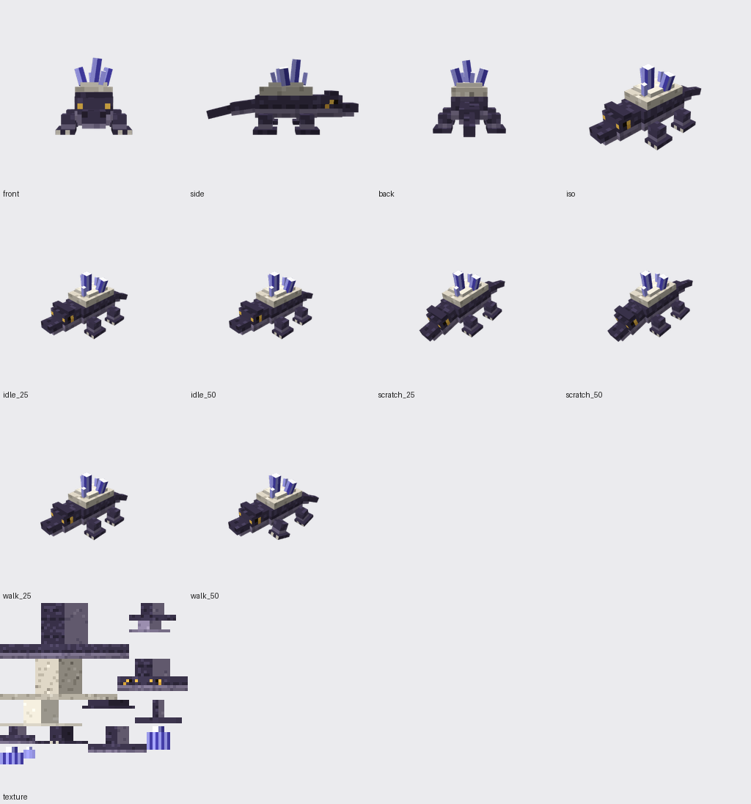
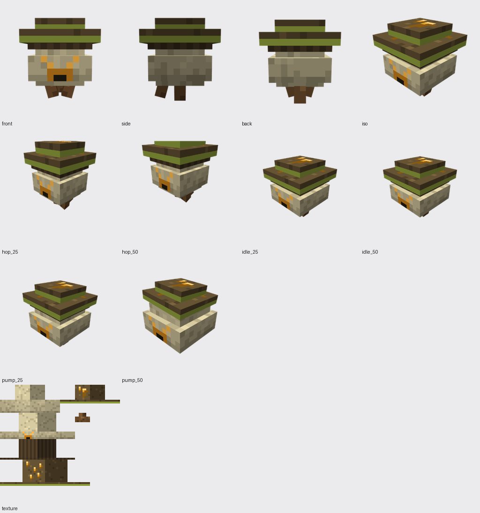
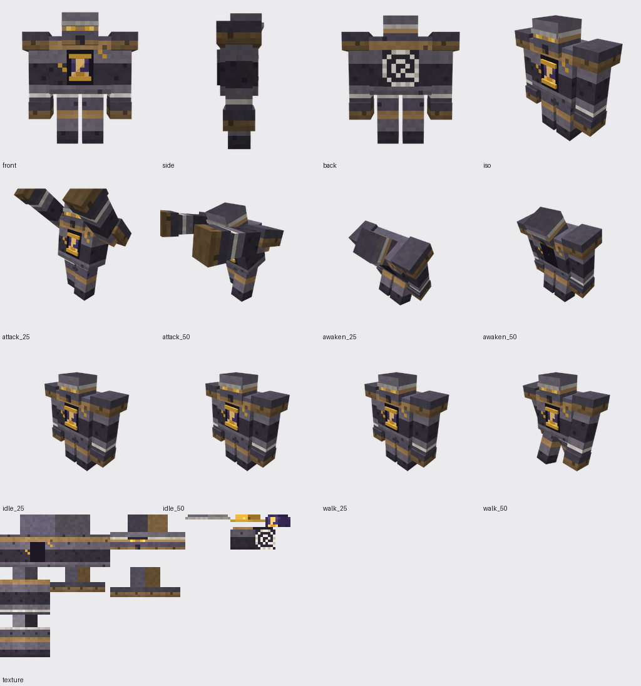

# Briefing: Strata – Tiefenzeit

> **Wofür diese Datei ist:** Sie ist der Einstiegs-Prompt für Claude (oder einen Menschen), der an diesem Repo weiterarbeitet. Am besten in eine neue Sitzung kopieren oder mit „Lies docs/BRIEFING.md“ starten. Sie beschreibt das Projekt, den Aufbau des Repos, die Regeln und die geplanten Mobs bis auf den Würfel genau.

---

## 1. Das Projekt in drei Sätzen

**Strata – Tiefenzeit** ist ein Set aus drei Minecraft-Mods für Modpacks (NeoForge). Spieler ziehen mit einem **Kernbohrer** Bohrkerne aus dem Boden. Jeder Kern zeigt eine Urzeit-**Epoche**, in die man über ein **Epochentor** reisen kann. Bleibt man zu lange, **verfestigt** sich die Zeit: Man wird langsamer, und um einen herum versteinern Blöcke.

Das ausführliche Konzept steht in [`KONZEPT.md`](../KONZEPT.md), der Mob-Plan in [`docs/MOBS.md`](MOBS.md).

## 2. Die drei Mods

| Mod | ID | Inhalt |
|---|---|---|
| **Strata Core** | `strata_core` | Datapack-Registries für Epochen und Kodex-Knoten, Kodex-Fortschritt am Spieler, `/strata`-Befehle, öffentliche API (`StrataAPI`, `CodexNodeUnlockedEvent`) |
| **Strata Epochs** | `strata_epochs` | Kernbohrer, Bohrkern, Epochentor, Zeitanker, Verfestigung, Dimensionen **Kristallzeit** und **Sporenzeit**, Blöcke und Erze |
| **Strata Bridge** | `strata_bridge` | JEI-Infoseiten, Jade-Hinweise, Advancements je Kodex-Knoten (für FTB Quests & Co.), alle Fremd-Mods optional |

**Unterstützte Versionen:** Minecraft 1.21.1, 1.21.11, 26.1, 26.2, 26.3, jeweils mit NeoForge. 26.x braucht Java 25, 1.21.x Java 21.

## 3. Die Welt (Stil und Stimmung)

| | Kristallzeit | Sporenzeit |
|---|---|---|
| Nebel/Himmel | Violett `#6e56b8` / `#2a1f4d` | Grün `#4f7a3a` / `#1f3318` |
| Boden | Calcit über Basalt | Myzel über Erde |
| Grundgestein | Zeitgestein (violettgrau, mit Schichten) | Zeitgestein |
| Erz | Kristallquarz (blauviolett) | Bernstein (mit eingeschlossenen Insekten) |
| Vorlage-Biom | Tropfsteinhöhlen | Üppige Höhlen |

**Mod-Farben:** Gold `#d9a43a` / `#ffe08a` und Violett `#7a4fd6` / `#b48cff`.
**Zeit-Motive:** Sanduhr, Gesteinsschichten (Strata), Ammonit.

**Stilregeln für Pixel-Art und Modelle:**
- Vanilla-Stil: kleine Paletten (4–6 Töne pro Material), Licht von oben links, keine weichen Verläufe.
- Blöcke kacheln nahtlos. Items haben einen dunklen, farbigen Umriss.
- Mobs werden nur aus Würfeln gebaut (Box-UV), mit 5–15 Würfeln und 4–12 Knochen. Normale Mobs haben eine 64×64-Textur, kleine 64×32 oder 32×32.
- Jede Textur wird von einem Prüf-Agenten mit **mindestens 7/10** freigegeben, bevor sie ins Spiel kommt.

## 4. Aufbau des Repos

```
KONZEPT.md                 Konzept des ganzen Sets
docs/BRIEFING.md           diese Datei
docs/MOBS.md               Mob-Plan (Team-Abstimmung, Architektur, Meilensteine)
versions/<v>/              MC-, NeoForge- und Java-Version + Quellgruppen pro Mod
common/                    reine Spiellogik ohne Minecraft (Epochenwahl, Kodex-Graph, Verfestigung) + JUnit
core/src/shared/           Strata Core, in allen Versionen gleich
core/src/mc_*/, dpreg_*/   Versionsanbindung (Klassen Mc, McDatapack)
epochs/src/shared/         Strata Epochs, in allen Versionen gleich (Code, Assets, Daten)
epochs/src/reg_*/, break_*/  Versionsanbindung (Reg, BreakHook)
epochs/worldgen/           Epochen-Spezifikation und Rezepte (Quelle für das Worldgen)
epochs/worldgen.gradle     erzeugt Worldgen, Loot und Rezepte pro Version aus Vanilla-Vorlagen
bridge/src/                Strata Bridge (JEI- und Jade-Plugins pro Versionsgruppe)
mobs/<id>/                 Mob-Baupläne (model.json), Textur, .bbmodel, Screenshots, Prüfblatt
tools/make_textures.py     Block- und Item-Texturen
tools/make_mob_textures.py Mob-Texturen aus den Bauplänen
tools/mob_sheet.py         Prüfblatt aus den Mob-Screenshots
tools/blockbench-mcp/      MCP-Server + Blockbench-Plugin (Claude baut Modelle in Blockbench)
scripts/smoke-test.sh      Server + Selbsttest in allen Versionen
scripts/client-screenshot.sh  Client-Screenshot in einer Epoche
```

**Prinzip:** Versionsunterschiede stecken nur in kleinen Anbindungsklassen. Alles, was Mojang zwischen Versionen umformatiert (Worldgen, Loot, Rezepte, Advancements), wird beim Bauen aus den Vanilla-Dateien genau dieser Version abgeleitet.

## 5. Bauen und testen

```bash
./gradlew :common:test                  # Spiellogik
./gradlew build                         # alle 3 Mods × 5 Versionen
scripts/smoke-test.sh                   # Server-Start + Selbsttests in allen Versionen
./gradlew :bridge-1.21.1:runClient      # Spiel mit dem ganzen Set + JEI + Jade
```

## 6. Arbeitsweise (Regeln für Claude)

1. **Nichts behaupten, was nicht geprüft ist.** Jede Änderung in allen 5 Versionen kompilieren und den Smoke-Test laufen lassen. Ungetestetes klar als ungetestet benennen.
2. **Bilder prüfen lassen.** Texturen und Modelle gehen an einen Prüf-Agenten (Designer). Freigabe erst bei mindestens 7/10, Kritik konkret umsetzen.
3. **Konzept vor Code.** Neue Inhalte zuerst kurz mit Rollen besprechen (Game Design, Programmierung, Projektmanagement), dann umsetzen.
4. **Pack-Autoren mitdenken.** Spielbalance gehört ins Datapack, technische Schalter in die Config.
5. **Kleine Schritte, jeder Schritt committet und gepusht.**

## 7. Mobs bauen mit Blockbench

**Werkzeuge:** Das Blockbench-MCP (`tools/blockbench-mcp/`) gibt Claude die Werkzeuge `new_project`, `build_model`, `set_texture`, `add_animation`, `screenshot`, `export` und weitere. Einrichtung steht in `tools/blockbench-mcp/README.md`.

**Ablauf für einen Mob:**
1. Bauplan in `mobs/<id>/model.json` schreiben: Knochen, Würfel mit Box-UV-Startpunkt und Material, Animationen.
2. `python3 tools/make_mob_textures.py <id>` malt die Textur passend zum UV-Layout.
3. In Blockbench bauen:
   - mit der Claude-App per MCP-Werkzeugen, oder
   - automatisch mit `node tools/blockbench-mcp/build_mobs.js <id>` (startet Blockbench headless, speichert `.bbmodel` und Screenshots).
4. `python3 tools/mob_sheet.py <id>` erzeugt das Prüfblatt `mobs/<id>/review_sheet.png`.
5. Ein **Designer-Agent prüft** das Prüfblatt mit Noten für Silhouette, Proportionen, Textur, Animation und Thema. Nachbessern, bis jeder Mob **mindestens 7/10** hat.

**Konventionen:**
- Format `modded_entity`, Box-UV.
- 16 Einheiten = 1 Block, y nach oben, Füße bei y = 0.
- Der Mob schaut nach **−z** (Norden).
- Drehpunkte (`origin`) liegen am Gelenk.
- Knochennamen in `snake_case`, Animationen heißen `animation.<mob>.<name>`.

## 8. Die Mobs

Alle drei Mobs wurden mit dem Blockbench-MCP gebaut und von einem **Designer-Agenten anhand von Screenshots geprüft**. Es waren drei Prüfrunden nötig, am Ende waren alle freigegeben (mindestens 7/10). Die Tabellen unten werden direkt aus den Bauplänen `mobs/<id>/model.json` erzeugt. Die Baupläne sind die verbindliche Quelle.

**Konventionen:**
- Koordinaten in Blockbench-Pixeln (16 = 1 Block), y nach oben, Mob schaut nach −z.
- Rotationen in Grad. Ein positiver X-Winkel schwingt einen hängenden Arm oder ein Bein **nach vorne**, ein negativer nach hinten. Bei Körper und Kopf hebt ein positiver X-Winkel die Nase.
- Ein positiver Z-Winkel schwenkt das untere Ende eines Beins auf der +x-Seite nach außen.

**Dateien pro Mob:**
- `model.json`: Bauplan
- `texture.png`: Textur
- `<id>.bbmodel`: Blockbench-Projekt mit eingebetteter Textur
- `shots/`: Ansichten und Animationsposen
- `review_sheet.png`: Prüfblatt

**Noch nicht geprüft:** Das Leuchten von Augen, Kristallen, Bernstein und Kern zeigt Blockbench nicht. Es muss im Spiel-Renderer nachgeholt werden.

### 8.1 Geodenkriecher (`geode_crawler`)



| | |
|---|---|
| Epoche | Kristallzeit |
| Rolle | neutral, greift nur an, wenn er angegriffen wird |
| Größe | ca. 1 Block breit, 0,75 Block hoch, 2,3 Blöcke lang (mit Schwanz) |
| Drop | Calcitschuppe (Material für den Bohrkopf, Stufe 2) |
| Spawn | Kristallzeit, Gruppen von 1–2, Licht egal |
| Textur | 64×64, Box-UV |
| Umfang | 10 Knochen, 22 Würfel, 3 Animationen |
| Design-Prüfung | 8/10 (Silhouette 8 · Proportionen 7 · Textur 7 · Animation 7 · Thema 8) |

**Verhalten:** Eine träge, niedrige Urzeitechse. Sie wandert langsam zu Kristallquarz-Erz in der Nähe und kratzt daran. Wer ihr folgt, findet Erz. Mit Kristallquarz lässt sie sich anlocken. Sie greift nur an, wenn sie angegriffen wird.

**Gestaltung:**
- **Körper:** violettgraue Schuppenhaut. Der Rücken ist dunkler, der Bauch hell (`#5D5470`-Familie), Schuppenreihen als versetzte dunkle Bögen.
- **Rücken:** Calcit-Platte in zwei Schichten (8×2×12 und 6×1×8), darauf fünf gestaffelte blauviolette Kristalle mit weißer Spitze, nach vorne gebündelt.
- **Kopf:** flach, mit verlängerter Schnauze, Kiefer und Brauenwulst. Goldene Augen (`#F2C14E`) mit Pupille, auch von vorne sichtbar. Nasenlöcher in Dunkelviolett.
- **Beine:** gespreizt, mit Füßen und hellen Krallenpixeln. Der Schwanz hängt leicht nach unten (+8°, Spitze +6°).
- **Leuchten (im Spiel):** Kristalle und Augen.

**Knochen:**

| Knochen | Eltern | Drehpunkt | Grundrotation |
|---|---|---|---|
| `body` | – | [0, 5.5, 0] | – |
| `back_plate` | `body` | [0, 9, 0] | – |
| `crystals` | `body` | [0, 10.5, 0] | – |
| `head` | `body` | [0, 6, -7] | – |
| `leg_front_left` | `body` | [5.5, 4, -4.5] | – |
| `leg_front_right` | `body` | [-5.5, 4, -4.5] | – |
| `leg_back_left` | `body` | [5.5, 4, 4.5] | – |
| `leg_back_right` | `body` | [-5.5, 4, 4.5] | – |
| `tail` | `body` | [0, 5.5, 7] | [8, 0, 0] |
| `tail_tip` | `tail` | [0, 5.5, 13] | [6, 0, 0] |

**Würfel:**

| Würfel | Knochen | von | bis | UV | Material | Rotation |
|---|---|---|---|---|---|---|
| `torso` | `body` | [-4, 3, -7] | [4, 8, 7] | [0, 0] | hide | – |
| `plate` | `back_plate` | [-4, 8, -6] | [4, 10, 6] | [0, 19] | calcite | – |
| `plate_top` | `back_plate` | [-3, 10, -4] | [3, 11, 4] | [0, 33] | calcite_light | – |
| `skull` | `head` | [-3, 3, -13] | [3, 8, -7] | [40, 19] | hide | – |
| `brow` | `head` | [-3.5, 8, -12] | [3.5, 9, -10] | [28, 33] | hide_dark | – |
| `snout` | `head` | [-2, 4, -17] | [2, 6, -13] | [44, 0] | hide | – |
| `jaw` | `head` | [-2, 3, -16] | [2, 4, -13] | [44, 6] | belly | – |
| `leg_fl` | `leg_front_left` | [4, 1, -6] | [7, 4, -3] | [0, 42] | hide | – |
| `leg_fr` | `leg_front_right` | [-7, 1, -6] | [-4, 4, -3] | [0, 42] (gespiegelt) | hide | – |
| `leg_bl` | `leg_back_left` | [4, 1, 3] | [7, 4, 6] | [0, 42] | hide | – |
| `leg_br` | `leg_back_right` | [-7, 1, 3] | [-4, 4, 6] | [0, 42] (gespiegelt) | hide | – |
| `foot_fl` | `leg_front_left` | [4, 0, -7] | [8, 1, -2] | [12, 42] | hide_dark | – |
| `foot_fr` | `leg_front_right` | [-8, 0, -7] | [-4, 1, -2] | [12, 42] (gespiegelt) | hide_dark | – |
| `foot_bl` | `leg_back_left` | [4, 0, 2] | [8, 1, 7] | [12, 42] | hide_dark | – |
| `foot_br` | `leg_back_right` | [-8, 0, 2] | [-4, 1, 7] | [12, 42] (gespiegelt) | hide_dark | – |
| `tail_base` | `tail` | [-2, 4, 7] | [2, 7, 13] | [30, 42] | hide | – |
| `tail_end` | `tail_tip` | [-1, 4.5, 13] | [1, 6.5, 19] | [46, 33] | hide | – |
| `crystal_main` | `crystals` | [-1, 10.5, -3] | [1, 16.5, -1] | [50, 42] | quartz | [-6, 0, 8] |
| `crystal_mid_r` | `crystals` | [1.5, 10.5, -1] | [3.5, 14.5, 1] | [0, 49] | quartz | [8, 0, -16] |
| `crystal_mid_l` | `crystals` | [-3.5, 10.5, 0] | [-1.5, 14.5, 2] | [0, 49] | quartz | [6, 0, 15] |
| `crystal_small_b` | `crystals` | [0, 10.5, 2] | [1, 13.5, 3] | [8, 49] | quartz | [14, 0, -6] |
| `crystal_small_f` | `crystals` | [-2, 10.5, -5] | [-1, 13.5, -4] | [8, 49] | quartz | [-10, 0, 12] |

**Animationen:**

| Name | Länge | Schleife | animierte Knochen |
|---|---|---|---|
| `animation.geode_crawler.idle` | 2.4 s | loop | head, tail |
| `animation.geode_crawler.walk` | 1.6 s | loop | body, leg_back_left, leg_back_right, leg_front_left, leg_front_right, tail |
| `animation.geode_crawler.scratch` | 1.4 s | once | body, head, leg_back_left, leg_back_right, leg_front_left |

### 8.2 Sporenbalg (`spore_bellows`)



| | |
|---|---|
| Epoche | Sporenzeit |
| Rolle | Gegner |
| Größe | ca. 0,75 Block breit, 0,9 Block hoch |
| Drop | Sporenbeutel (Zutat für „Keimfrische“, die die Verfestigung zurücksetzt) |
| Spawn | Sporenzeit, auf Myzel, Gruppen von 1–3 |
| Textur | 128×64, Box-UV |
| Umfang | 6 Knochen, 9 Würfel, 3 Animationen |
| Design-Prüfung | 7/10 (Silhouette 7 · Proportionen 7 · Textur 7 · Animation 7 · Thema 7) |

**Verhalten:** Ein pilziger Sack auf drei Wurzelbeinen. Er hüpft auf Spieler zu, pumpt sich auf und stößt eine grüne Sporenwolke aus. Die Wolke macht keinen Schaden, sondern **verdoppelt 3 Sekunden lang die Verfestigung**. So setzt er den Spieler unter Zeitdruck.

**Gestaltung:**
- **Sack:** helle Membran (`#CFC39A`) mit Adern (`#9C8F6A`) und einem breiteren Bauchwulst.
- **Gesicht** (auf dem Bauch): schmale, schräge Bernsteinaugen und ein Sporenventil (3×2 dunkel mit Bernsteinrand). Dort tritt die Wolke aus.
- **Hut:** gewölbt in drei Stufen (12×2×12, 10×1×10, 6×1×6) in Umbra (`#5B4A2E`), darunter dunkle Lamellen. Ein gelbgrüner Rand nur ganz unten, Bernsteinpunkte (`#E0A030`, Glanz `#FFD27A`) oben und an allen Seiten.
- **Wurzeln:** drei Wurzelbeine, nach außen gespreizt (A-Stand).
- **Leuchten (im Spiel):** Augen und Bernsteinpunkte.

**Knochen:**

| Knochen | Eltern | Drehpunkt | Grundrotation |
|---|---|---|---|
| `body` | – | [0, 0, 0] | – |
| `sack` | `body` | [0, 6.5, 0] | – |
| `cap` | `body` | [0, 10, 0] | – |
| `leg_left` | `body` | [3, 3, 0] | – |
| `leg_right` | `body` | [-3, 3, 0] | – |
| `leg_back` | `body` | [0, 3, 3] | – |

**Würfel:**

| Würfel | Knochen | von | bis | UV | Material | Rotation |
|---|---|---|---|---|---|---|
| `sack_core` | `sack` | [-4, 3, -4] | [4, 10, 4] | [0, 0] | membrane | – |
| `belly` | `sack` | [-5, 4, -5] | [5, 8, 5] | [0, 15] | membrane | – |
| `gills` | `cap` | [-5, 9, -5] | [5, 10, 5] | [0, 29] | gill | – |
| `cap_main` | `cap` | [-6, 10, -6] | [6, 12, 6] | [0, 40] | cap | – |
| `cap_mid` | `cap` | [-5, 12, -5] | [5, 13, 5] | [64, 0] | cap | – |
| `cap_top` | `cap` | [-3, 13, -3] | [3, 14, 3] | [32, 0] | cap | – |
| `root_left` | `leg_left` | [2, 0, -1] | [4, 3, 1] | [40, 15] | root | [0, 0, 15] |
| `root_right` | `leg_right` | [-4, 0, -1] | [-2, 3, 1] | [40, 15] (gespiegelt) | root | [0, 0, -15] |
| `root_back` | `leg_back` | [-1, 0, 2] | [1, 3, 4] | [40, 15] | root | [-15, 0, 0] |

**Animationen:**

| Name | Länge | Schleife | animierte Knochen |
|---|---|---|---|
| `animation.spore_bellows.idle` | 2 s | loop | cap, sack |
| `animation.spore_bellows.hop` | 0.6 s | loop | body, leg_back, leg_left, leg_right |
| `animation.spore_bellows.pump` | 1.2 s | once | cap, sack |

### 8.3 Steinzeuge (`petrified_witness`)



| | |
|---|---|
| Epoche | beide |
| Rolle | Gegner, Vorlage für einen späteren Mini-Boss |
| Größe | ca. 1,6 Blöcke breit, 1,9 Blöcke hoch |
| Drop | Kodex-Fragment (schaltet Erdkodex-Knoten frei), selten versteinerter Stein mit Ammonit |
| Spawn | entsteht aus versteinerten Blöcken bei Spielern, die zu lange in einer Epoche bleiben (per Config abschaltbar) |
| Textur | 128×64, Box-UV |
| Umfang | 10 Knochen, 15 Würfel, 4 Animationen |
| Design-Prüfung | 7,5/10 (Silhouette 7 · Proportionen 7 · Textur 7 · Animation 7 · Thema 8) |

**Verhalten:** Das Echo eines Reisenden, der zu lange blieb. Er erwacht langsam aus versteinertem Stein und schlägt mit beiden Fäusten zu wie ein Golem. Er macht die Strafe der Verfestigung sichtbar.

**Gestaltung:**
- **Körper:** breiter Steinkörper. Die Gesteinsschichten richten sich nach der Welthöhe und laufen über Torso, Arme und Beine auf gleicher Höhe durch. Farben: Schiefer `#3C3742`, Grau `#77707C`, Ocker `#B08A5A`, Calcit-Linie `#DCD6CF`. Dazu Risse mit Goldadern.
- **Kopf:** eingesunken und nach vorne geschoben, mit Stirnkante, glühenden Augenschlitzen (`#FFD86B`) und einem Ockerband auf Augenhöhe.
- **Brust:** goldene Sanduhr (Kappen oben und unten, Glas mit goldenem Sand) in einer dunklen Nische.
- **Rücken:** Ammonit-Relief (8×8), von Hand gezeichnete Spirale.
- **Arme:** eigene Schulterblöcke, die bei Angriffen nur leicht mitgehen, und schwere Fäuste.
- **Leuchten (im Spiel):** Augen und Sanduhr-Kern (pulsiert im Idle, leuchtet beim Erwachen auf).

**Knochen:**

| Knochen | Eltern | Drehpunkt | Grundrotation |
|---|---|---|---|
| `root` | – | [0, 0, 0] | – |
| `body` | `root` | [0, 12, 0] | – |
| `head` | `body` | [0, 24, -1] | – |
| `core` | `body` | [0, 18, -4] | – |
| `shoulder_left` | `body` | [9, 23, 0] | – |
| `shoulder_right` | `body` | [-9, 23, 0] | – |
| `arm_left` | `body` | [9, 23, 0] | – |
| `arm_right` | `body` | [-9, 23, 0] | – |
| `leg_left` | `root` | [3, 12, 0] | – |
| `leg_right` | `root` | [-3, 12, 0] | – |

**Würfel:**

| Würfel | Knochen | von | bis | UV | Material | Rotation |
|---|---|---|---|---|---|---|
| `torso` | `body` | [-7, 12, -4] | [7, 25, 4] | [0, 0] | strata | – |
| `ammonite` | `body` | [-4, 14, 4] | [4, 22, 5] | [92, 5] | strata_dark | – |
| `skull` | `head` | [-4, 23, -5] | [4, 30, 2] | [44, 0] | strata | – |
| `brow` | `head` | [-4, 27, -5.5] | [4, 28, -4.5] | [74, 0] | strata_dark | – |
| `cap_top` | `core` | [-2.5, 20, -4.5] | [2.5, 21, -2.5] | [92, 0] | gold | – |
| `cap_bottom` | `core` | [-2.5, 15, -4.5] | [2.5, 16, -2.5] | [92, 0] | gold | – |
| `glass` | `core` | [-2, 16, -4] | [2, 20, -3] | [106, 0] | glass | – |
| `shoulder_left` | `shoulder_left` | [7, 22, -4] | [13, 26, 4] | [44, 21] | strata_dark | – |
| `shoulder_right` | `shoulder_right` | [-13, 22, -4] | [-7, 26, 4] | [44, 21] (gespiegelt) | strata_dark | – |
| `arm_l` | `arm_left` | [7, 10, -2.5] | [12, 24, 2.5] | [0, 21] | strata | – |
| `arm_r` | `arm_right` | [-12, 10, -2.5] | [-7, 24, 2.5] | [0, 21] (gespiegelt) | strata | – |
| `fist_l` | `arm_left` | [7, 6, -3] | [12, 10, 3] | [20, 21] | strata_dark | – |
| `fist_r` | `arm_right` | [-12, 6, -3] | [-7, 10, 3] | [20, 21] (gespiegelt) | strata_dark | – |
| `leg_l` | `leg_left` | [0.5, 0, -2.5] | [5.5, 12, 2.5] | [0, 40] | strata | – |
| `leg_r` | `leg_right` | [-5.5, 0, -2.5] | [-0.5, 12, 2.5] | [0, 40] (gespiegelt) | strata | – |

**Animationen:**

| Name | Länge | Schleife | animierte Knochen |
|---|---|---|---|
| `animation.petrified_witness.idle` | 3 s | loop | body, core, head |
| `animation.petrified_witness.walk` | 1.6 s | loop | arm_left, arm_right, body, leg_left, leg_right, shoulder_left, shoulder_right |
| `animation.petrified_witness.attack` | 1 s | once | arm_left, arm_right, body, leg_left, leg_right, shoulder_left, shoulder_right |
| `animation.petrified_witness.awaken` | 2.2 s | once | arm_left, arm_right, body, core, head, leg_left, leg_right, root |

### 8.4 Nächste Schritte für die Mobs

1. **Grundlage im Code (M0):** gemeinsame Basisklasse `StrataMob`, ein generischer Renderer pro Versionsgruppe (1.21.1 / ab 1.21.2 mit Render States / 26.x), Modelle aus den Bauplänen als `LayerDefinition`, eigener kleiner Keyframe-Abspieler, Spawns per Biome-Modifier. Siehe `docs/MOBS.md`.
2. **Geodenkriecher ins Spiel (M1)**, dann Sporenbalg (M2) und Steinzeuge (M3), jeweils nach der Definition of Done in `docs/MOBS.md`.
3. **Leuchten** (Augen, Kristalle, Bernstein, Kern) als eigene Leucht-Ebene im Renderer und im Spiel per Screenshot prüfen lassen.
4. **Optionale Hinweise des Designers:**
   - Sporenbalg: Wurzeln beim Sprung seitlich abspreizen (z ±10°), Pump-Scale auf 1.2 deckeln, damit der Hut dominant bleibt.
   - Steinzeuge: Ammonit mit sichtbarer Mündung, Torso etwas tiefer.
